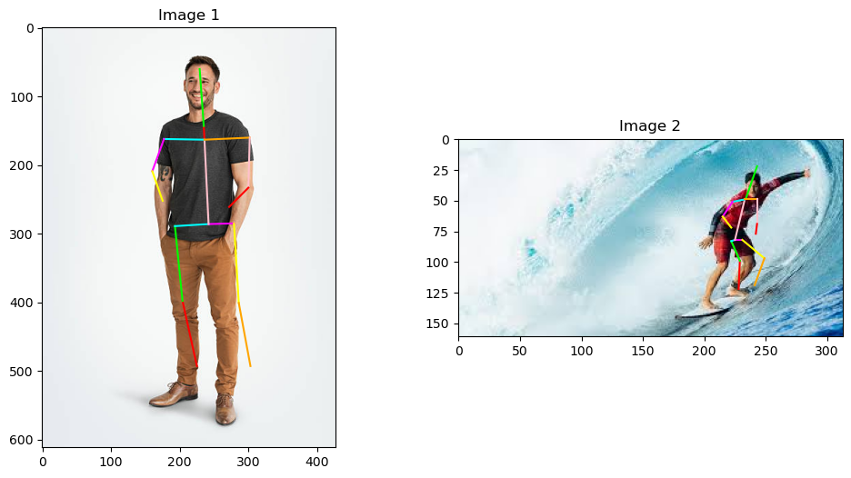
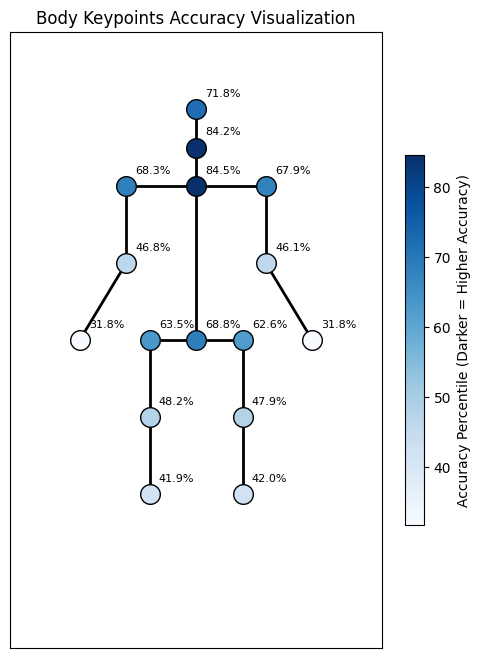
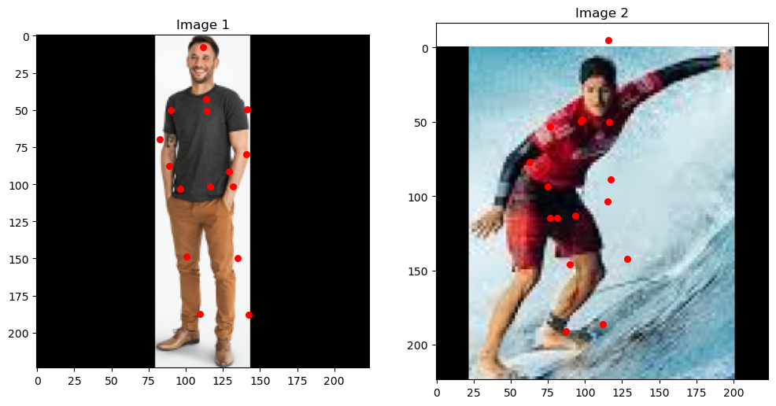

# LimbsID — Human Pose Estimation from Scratch

Final project for the **Samsung Innovation Campus**.

LimbsID detects **16 body keypoints** (ankles, knees, hips, pelvis, thorax, neck, head, wrists, elbows, shoulders) in a single image. It uses a convolutional neural network that we designed and trained from scratch in PyTorch on the [MPII Human Pose](http://human-pose.mpi-inf.mpg.de/) dataset. A live runner applies the model to webcam video and draws the skeleton in real time. We built it with posture monitoring in mind.



---

## Highlights

- **Custom CNN, no pretrained backbone.** We went through five architecture versions plus a ResNet-style variant (see [`training/everyModelDocumentation.py`](training/everyModelDocumentation.py)).
- **Preprocessing pipeline.** YOLOv8 crops the person, the image is resized and padded to 224×224 with its aspect ratio kept, and the keypoints are moved into the new coordinate space. A reverse transform maps predictions back to the original image.
- **Data augmentation:** rotation, brightness, Gaussian noise, random noise and blur.
- **Evaluation with PCK** (Percentage of Correct Keypoints) for each joint.
- **Live inference** from a webcam with OpenCV.

## Results

The final residual model (`ResPoseNet`) was trained for 200 epochs on about 22k augmented MPII samples, with SmoothL1 loss and Adam. It reaches **~58% PCK** on the validation set, counting a keypoint as correct when it lands within 20 px of the ground truth on a 224×224 image.

| Accuracy per joint (PCK) | Preprocessing output (224×224) |
|---|---|
|  |  |

The head, neck and thorax are the easiest joints (~84%). Wrists are the hardest (~32%) because they move the most and are often hidden behind the body.

## Project structure

```
LimbsID-Samsung-Final-Project/
├── Datasets/
│   └── mpii_human_pose.csv        # MPII keypoint annotations (~25k images)
├── EDA/                           # Exploratory data analysis
│   ├── EDAmpii.ipynb              # missing joints, image sizes, scale, colour, outliers
│   ├── EDAmpii2.ipynb             # scale & keypoint-count distributions
│   └── 000003072.jpg              # sample image
├── preprocessing/
│   ├── resizeImage.py             # YOLO person crop + resize/pad + keypoint transform → .pkl dataset
│   ├── pre-process.py             # augmentation helpers (rotate, brightness, noise, blur) + visual demo
│   ├── testTheModel.ipynb         # runs a trained model on new images and plots the skeleton
│   └── surfar.jpeg                # sample test image
├── training/
│   ├── everyModelDocumentation.py # every architecture we tried (PoseNetV1…V5, ResPoseNet), with notes
│   ├── ModelTrainingFile.py       # Dataset, PoseNet and the training/validation loop
│   ├── simplifiedTraining.ipynb   # short notebook that drives ModelTrainingFile
│   ├── modelTraining.ipynb        # full training run (Google Colab, GPU)
│   └── PCKcriteria.ipynb          # PCK evaluation + per-joint accuracy plot
├── LiveModel/
│   ├── modelRunner.py             # real-time webcam inference
│   └── resizeImage.py             # frame-based version of the preprocessing transform
├── trained_models/
│   └── posev00072.pth             # trained weights (PoseNetV4 architecture)
├── docs/
│   ├── images/                    # figures used in this README
│   └── references.md              # papers we studied
├── pyproject.toml / uv.lock       # pinned, reproducible environment
└── requirements.txt               # same dependencies, for plain pip
```

## Getting started

The project needs **Python 3.12**. Newer versions such as 3.13+ don't have wheels for some of the libraries (MediaPipe, for example). The easiest way to get the right Python and every dependency in one step is [**uv**](https://docs.astral.sh/uv/). It downloads Python 3.12 for you and installs the exact versions in `uv.lock` into a local `.venv`, so you don't install anything by hand.

### 1. Install uv (once per computer)

```bash
curl -LsSf https://astral.sh/uv/install.sh | sh
```

(On macOS you can also use `brew install uv`. On Windows: `powershell -c "irm https://astral.sh/uv/install.ps1 | iex"`.)

### 2. Clone and install

```bash
git clone https://github.com/bernaprioste1704/LimbsID-Samsung-Final-Project.git
cd LimbsID-Samsung-Final-Project
uv sync
```

### 3. Run

Start any command with `uv run` and it uses the project's environment automatically:

```bash
uv run jupyter lab                       # open the notebooks (EDA, training, evaluation)
uv run python preprocessing/pre-process.py   # visual demo of the augmentations
cd LiveModel && uv run python modelRunner.py # live webcam inference
```

If you'd rather activate the environment yourself, run `source .venv/bin/activate`. On Windows it's `.venv\Scripts\activate`. After that, plain `python` and `jupyter` work.

<details>
<summary>Without uv (plain pip + venv)</summary>

You need Python 3.12 installed.

```bash
python3.12 -m venv .venv
source .venv/bin/activate        # Windows: .venv\Scripts\activate
pip install -r requirements.txt
```
</details>

## Data

- **Annotations:** [`Datasets/mpii_human_pose.csv`](Datasets/mpii_human_pose.csv) is included. Missing joints are marked with `-1`.
- **Images:** the MPII images (~12 GB) are not in the repo. Download them from the [MPII Human Pose website](http://human-pose.mpi-inf.mpg.de/) and extract them to `Datasets/images/`.
- **Preprocessed datasets** (`dataset*.pkl`) are produced by `preprocessing/resizeImage.py` (`process_dataset`). They are too large for GitHub and are git-ignored.
- **YOLOv8 weights** (`yolov8n.pt` / `yolov8l.pt`) download automatically the first time they are used.

## Pipeline

1. **EDA:** look at missing joints, image resolutions, scale and colour distributions.
2. **Preprocessing:** crop the person with YOLOv8, letterbox to 224×224, move the keypoints and normalise them to [0, 1].
3. **Augmentation:** rotation, brightness, noise and blur, which roughly doubles the dataset to ~22k samples.
4. **Training:** a CNN regressor with 32 outputs (x, y for each joint, normalised to [0, 1]), trained with SmoothL1 loss and Adam.
5. **Evaluation:** PCK per joint.
6. **Inference:** the webcam loop draws the predicted skeleton on every frame.

### Model evolution

| Version | Change |
|---|---|
| V1 | Baseline: 3 conv layers + fully connected head |
| V2 / V3 | Fourth conv layer, Flatten, and Dropout in the fully connected head |
| V4 | BatchNorm in every layer, Adaptive Pooling, Tanh output (weights shipped in `trained_models/`) |
| V5 | 4 → 5 conv blocks, Tanh → **Sigmoid** output |
| ResPoseNet | Residual blocks (ResNet-style skip connections), the final model |

## Known limitations

These scripts are kept exactly as they were during the project:

- `preprocessing/resizeImage.py` imports `winsound`, which only exists on **Windows**. It's only used to beep when dataset processing finishes.
- `LiveModel/modelRunner.py` uses the residual `PoseNet` and loads `posev0.01126.pth`, which isn't in the repo. The included `posev00072.pth` matches the **PoseNetV4** architecture instead.
- Several notebooks expect local files that aren't versioned (the MPII images, `dataset*.pkl`, other checkpoints). Their saved outputs still show the results.
- `training/modelTraining.ipynb` was written for **Google Colab** (it mounts Google Drive).
- `EDA/EDAmpii2.ipynb` reads `mpii_human_pose.csv` from its own folder. Copy the CSV next to it to re-run it (`EDAmpii.ipynb` reads it from `../Datasets/` and runs fine).

## Team

- Bernardo Delgado Prioste
- Miguel Cid Flor
- Miguel Nunes

Built as part of the **Samsung Innovation Campus** programme. See [docs/references.md](docs/references.md) for the papers that guided the project.
